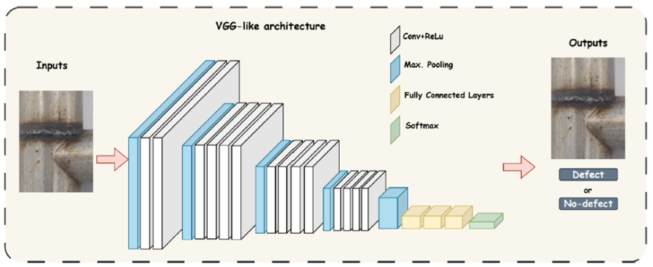
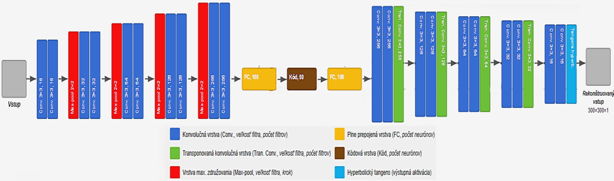
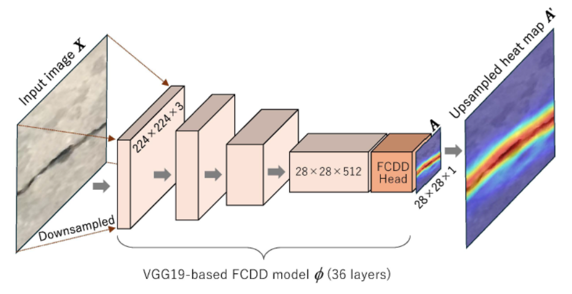

# KEGA Projekt - Laboratórium aplikovaných technológií umelej inteligencie

## Zameranie projektu
Projekt sa zameriava na vybudovanie moderného laboratória aplikovaných technológií umelej
inteligencie pre priemysel. Laboratórium bude pozostávať z 5 rôznych pracovísk zameraných na
spracovanie obrazu, videa a zvuku pre priemyselné aplikácie. Pracoviská sú navrhnuté tak, aby mohli
byť nezávislé od operačného systému (Linux, Windows) a softvéru pre HNS (Matlab, Python, ...).
Laboratórium budú využívať študenti 3. ročníka bakalárskeho štúdia a študenti 1. a 2. ročníka
inžinierskeho štúdia na vybraných predmetoch a študenti bakalárskych, diplomových, individuálnych
a tímových prác, ale aj doktorandi. Plánujeme nasledovné pracoviská:

## Pracovisko 1 - Kontrola kvality výrobkov pomocou hlbokých neurónových sietí
Počítačová zostava s výkonnou grafickou kartou, kvalitná hĺbková kamera, priemyselný riadiaci systém, model. 
Cieľom pracoviska bude spracovanie obrazu na kontrolu kvality objektov (výrobkov).

### Klasifikácia defektov zvarov pomocou hlbokých neurónových sietí.
**Klasifikácia defektov zvarov pomocou vizuálnej kontroly**

Kontrola kvality zvarových spojov predstavuje dôležitú súčasť zabezpečenia spoľahlivosti a bezpečnosti zváraných konštrukcií. 
Automatizovaná vizuálna kontrola s využitím priemyselných kamier a laserových skenerov umožňuje bezkontaktné získavanie informácií o povrchu zvarov a identifikáciu rôznych typov defektov, ako sú trhliny, pórovitosť, zápaly, prevýšenie či nepravidelná geometria zvaru.
Kamerové systémy poskytujú dvojrozmerné obrazy zachytávajúce vzhľad a povrchové charakteristiky zvaru, zatiaľ čo laserové skenery umožňujú získavať trojrozmerné údaje o jeho geometrii a povrchových nerovnostiach. 
Na automatickú detekciu a klasifikáciu defektov možno využiť metódy spracovania obrazu a hlbokého učenia, predovšetkým konvolučné neurónové siete (CNN). 
Kombinácia obrazových a geometrických údajov vytvára predpoklady na zvýšenie spoľahlivosti rozpoznávania defektov a umožňuje objektívne hodnotenie kvality zvarových spojov v priemyselných podmienkach. 
Na obrázku je znázornený princíp klasifikácie defektov zvarov pomocou CNN, kde obraz z kamery vstupuje do CNN, ktorá z obrazu získa príznaky potrebné na binárnu klasifikáciu Defekt/Bez defektu alebo viactriednu, kde sa určí aj typ defektu.

Obr.1 Principiálna schéma klasifikácie defektov zvarov pomocou CNN

#### Dataset - Kontrola kvality zvarov z kamery – 4 skupiny (Ok, 2025-kráterový lunker, 510-diera, 500-poškodený povrch zvaru):
[Weld_Defect_Camera_Dataset](https://drive.google.com/drive/folders/1SUivIX-uDGs74XNegNQp95wvQ78C5DIe?usp=drive_link)

Dataset - Kontrola kvality zvarov z laserového skenera – 2 skupiny (binárna klasifikácia Good/Bad Weld):
[Weld_Defect_Laser_Dataset](https://drive.google.com/drive/folders/1dyKmhW-oL_biiiVoooNsTCJpm8OgUhDl?usp=drive_link)

Dosiahnuté výsledky:
- Švec, Klasifikácia defektov robotmi realizovanými zvarmi AI nástrojom, DP FEI STU Bratislava, 2024, [Prezentacia_DP_Svec_Klasifikacia_defektov_zvarov_kamera](document/Prezentacia_DP_Svec_Klasifikacia_defektov_zvarov.pdf)

- Adam, Detekcia defektov zvarov pomocou hlbokých neurónových sietí, DP FEI STU Bratislava, 2025, [Prezentacia_DP_Adam_Klasifikacia_defektov_zvarov_laser](document/Prezentacia_DP_Adam_Klasifikacia_defektov_zvarov.pdf)

- Palček, Vizuálna kontrola zvarov pomocou hlbokých neurónových sietí, DP FEI STU Bratislava, 2026, [Prezentacia_DP_Palcek_Klasifikacia_defektov_zvarov_plechov](document/Prezentacia_DP_Palcek_Klasifikacia_defektov_zvarov.pdf)

Literatúra:
- S. Kajan, M. Trebuľa, F. Duchoň, Z. Kovaríková, M. Švolík and D. Švec, "Robotic Vision Inspection of Weld Quality Using Convolutional Neural Networks," 2024 25th International Carpathian Control Conference (ICCC), Krynica Zdrój, Poland, 2024, pp. 01-05, doi: 10.1109/ICCC62069.2024.10569157. [Kajan_kol_Weld_Visual_Inspection](https://ieeexplore.ieee.org/document/10569157)

- S. Kajan, M. Trebuľa, F. Duchoň, Z. Kovaríková, M. Kováč and J. Pavlovičová, "Weld Defect Recognition and Detection from Video Using Deep Learning Methods," 2025 Cybernetics & Informatics (K&I), Mikulov na Morave, Czech Republic, 2025, pp. 1-5, doi: 10.1109/KI64036.2025.10916449. [Kajan_kol_Weld_Defect_Recognition](https://ieeexplore.ieee.org/document/10916449)

- S. Kajan, M. Trebuľa, "Robotická vizuálna kontrola zvarov využitím metód hlbokého učenia," ATP Journal júl 2025. [Kajan_Trebula_Weld_Defect_ATP](https://www.atpjournal.sk/rubriky/prehladove-clanky/roboticka-vizualna-kontrola-zvarov-vyuzitim-metod-hlbokeho-ucenia.html?page_id=42144)

### Detekcia defektov výrobkov pomocou autoenkóderov a FCDD hlbokých neurónových sietí.
**Detekcia defektov výrobkov (casting dataset) pomocou Autoenkódera a FCDD**

Automatická vizuálna kontrola kvality výrobkov predstavuje významnú oblasť využitia metód umelej inteligencie v priemyselnej výrobe. 
Jednou z dôležitých úloh je identifikácia defektných výrobkov na základe analýzy ich obrazových údajov. 
Pri riešení tejto úlohy sa čoraz častejšie využívajú metódy hlbokého učenia zamerané na detekciu anomálií, ktoré umožňujú rozpoznávať defekty aj bez potreby rozsiahlych množín označených obrazov chybných výrobkov.

Cieľom úlohy je navrhnúť a experimentálne porovnať metódy klasifikácie defektných a bezchybných výrobkov založené na **autoenkóderoch (AE)** a **hlbokých neurónových sieťach FCDD (Fully Convolutional Data Description)**. 
Autoenkódery využívajú princíp rekonštrukcie vstupného obrazu, pričom odchýlky medzi pôvodným a rekonštruovaným obrazom môžu indikovať prítomnosť defektov. 
Metóda FCDD je založená na učení príznakovej reprezentácie obrazov a umožňuje identifikovať anomálne oblasti prostredníctvom priestorových máp anomálií.
Na experimentálne overenie navrhnutých riešení bude použitý verejne dostupný **dataset Casting**, ktorý obsahuje obrazy bezchybných a defektných kovových odliatkov. 
Súčasťou riešenia bude predspracovanie obrazových údajov, návrh a trénovanie neurónových modelov, optimalizácia ich parametrov a vyhodnotenie dosiahnutých výsledkov pomocou vhodných klasifikačných metrík. 
Osobitná pozornosť bude venovaná porovnaniu úspešnosti klasifikácie jednotlivých metód a možnostiam lokalizácie defektov na povrchu výrobkov vizualizačnými technikami Grad-CAM.

Obr.2 Architektúra autoenkódera na detekciu defektov

Obr.3 Architektúra FCDD na detekciu defektov

#### Casting Dataset - obrazy bezchybných a defektných kovových odliatkov – binárna klasifikácia:
[Casting_Dataset_Drive](https://drive.google.com/drive/folders/1pNCrX0CoxX2uKjdOMzKOOCkc1X3u8WQc?usp=drive_link) , 
[Casting_Dataset_Kaggle](https://www.kaggle.com/datasets/ravirajsinh45/real-life-industrial-dataset-of-casting-product)

Dosiahnuté výsledky:
- Palček, Vizuálna kontrola zvarov pomocou hlbokých neurónových sietí, DP FEI STU Bratislava, 2026, [Prezentacia_SVOC_Palcek_Detekcia_defektov](document/Prezentacia_SVOC_Palcek_Detekcia_defektov.pdf)

Literatúra:
- Palček, Kajan, "Experimentálne porovnanie metód hlbokého učenia pre vizuálnu inšpekciu defektov," ŠVOČ, FEI STU Bratislava, 2026, [Palcek_Kajan_SVOC](document/Palcek_SVOC.pdf)

- J.K. Chow, Z. Su, J. Wu, P.S. Tan, X. Mao, Y.H. Wang.,Anomaly detection of defects on concrete structures with
the convolutional autoencoder. ScienceDirect - Advanced Engineering Informatics, Volume 45:4–5 str., August 2020, [Anomaly_detection_defects_autoenkoder](https://www.sciencedirect.com/science/article/pii/S1474034620300744)

- P. Liznerski, L. Ruff, R. A. Vandermeulen, B. J. Franks, M. Kloft, and K.-R. Müller. Explainable deep one-class
classification. Preprint arXiv:2007.01760, Marec 18, 2021. [Anomaly_detection_defects_FCDD](https://arxiv.org/abs/2007.01760)

- L. Ruff, R. A. Vandermeulen, B. J. Franks, K.-R. Müller, and M. Kloft. Rethinking assumptions in deep anomaly
detection. Preprint arXiv:2006.00339, Máj 30, 2020. [Anomaly_detection_defects_2](https://arxiv.org/abs/2006.00339)

- K. Simonyan and A. Zisserman. Very deep convolutional networks for large-scale image recognition. Preprint
arXiv:1409.1556, April 10, 2015. [Anomaly_detection_defects_3](https://arxiv.org/abs/1409.1556)

### Praktické príklady klasifikácie defektov pomocou CNN.
**Praktické príklady defektov - jamy na ceste, defekty na pneumatikách, detekcia požiaru**

V praxi sa veľmi často stretávame s riešením úloh detekcie defektných (anomálnych) stavov. Na príkladoch ako sú jamy na ceste, defekty na pneumatikách, detekcia požiaru si overíme schopnosť CNN riešiť problematiku detekcie defektov.  
Cieľom úlohy je navrhnúť a experimentálne porovnať rôzne štruktúry CNN alebo Vizuálnych transformerov (ViT) pre rôzne úlohy klasifikácie defektov.
Na experimentálne overenie navrhnutých riešení budú použité verejne dostupné datasety. 
Súčasťou riešenia bude predspracovanie obrazových údajov, návrh a trénovanie neurónových modelov, optimalizácia ich parametrov a vyhodnotenie dosiahnutých výsledkov pomocou vhodných klasifikačných metrík. 
Osobitná pozornosť bude venovaná porovnaniu úspešnosti klasifikácie jednotlivých modelov a možnostiam lokalizácie defektov na obraze vizualizačnými technikami Grad-CAM.

#### Datasety detekcia defektov - jamy na ceste, defekty na pneumatikách, detekcia požiaru:
[Jamy_cesta_Dataset_Drive](https://drive.google.com/drive/folders/1d3atNCQK9POrsjQJiVZ6M8HoPEfCaTn6?usp=drive_link) 

[Pneumatiky_Dataset_Drive](https://drive.google.com/drive/folders/1EO9dj8x2OM21ZSBs8xlqTLSzH-FDLOBB?usp=drive_link)

[Poziar_Dataset_Kaggle](https://www.kaggle.com/datasets/amerzishminha/forest-fire-smoke-and-non-fire-image-dataset)

